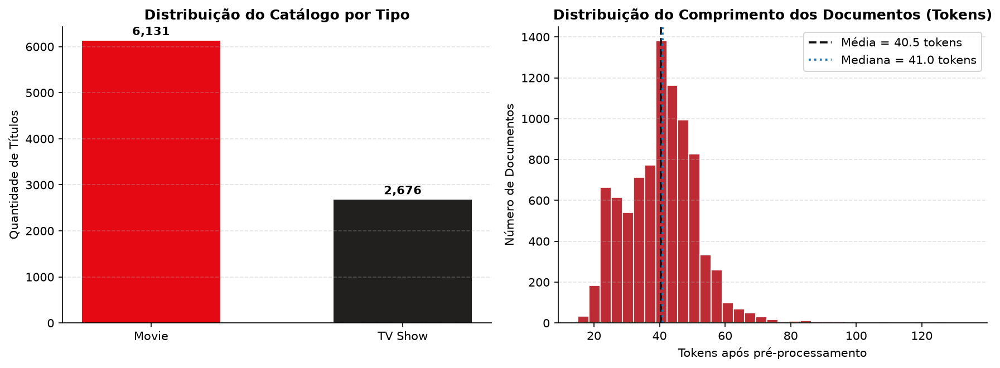
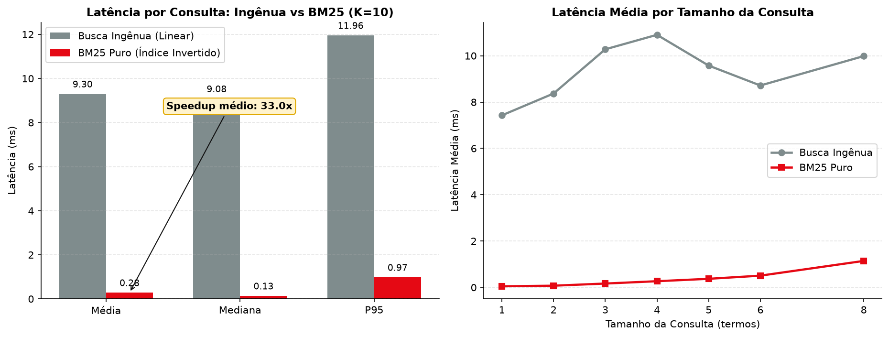
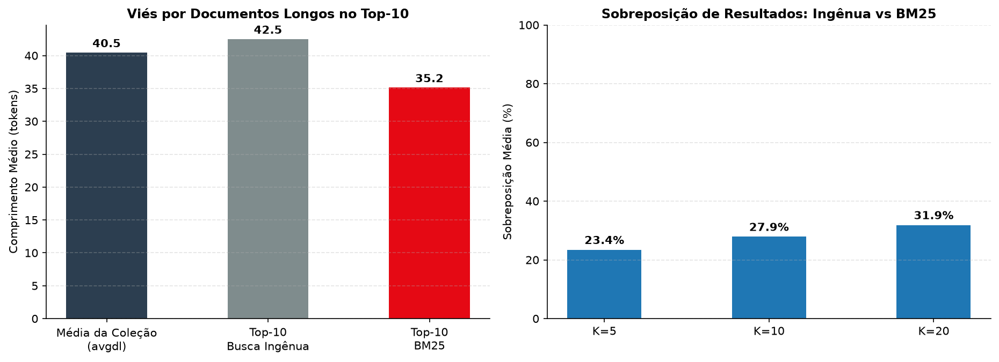
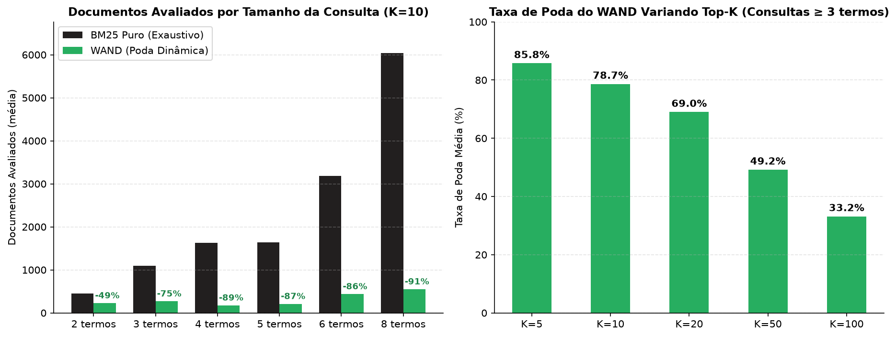
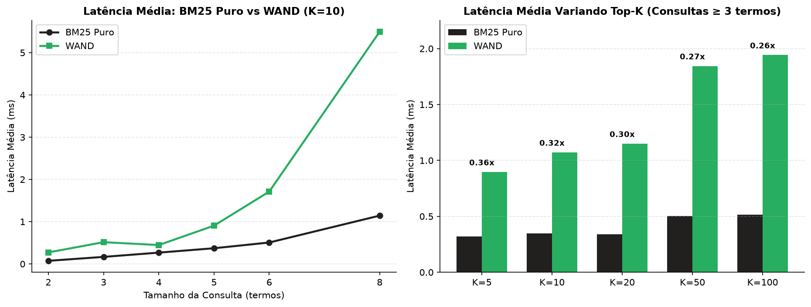
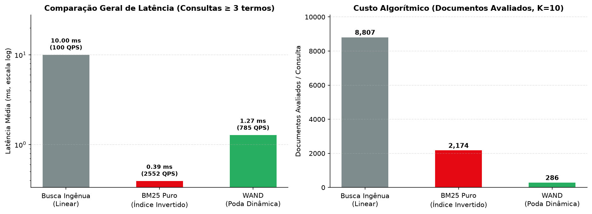

# Relatório de Benchmark — Mecanismo de Busca em PLN (Ingênua vs. BM25 vs. WAND)

**Disciplina:** Processamento de Linguagem Natural (PLN)  
**Dataset:** [Netflix Movies and TV Shows (`netflix_titles.csv`)](https://www.kaggle.com/datasets/shivamb/netflix-shows)  
**Algoritmos avaliados:** Busca Ingênua (varredura linear), Okapi BM25 puro (índice invertido exaustivo) e WAND (*Weak AND* com poda dinâmica).

---

## 1. Visão Geral do Corpus e Pré-processamento

O catálogo extraído de `netflix_titles.csv` contém **8.807 títulos**, divididos entre **6.131 filmes (`Movie`, 69,6%)** e **2.676 séries (`TV Show`, 30,4%)**. Para tornar cada registro pesquisável por título, gênero, elenco, direção, país e sinopse, concatenamos os campos textuais `title`, `listed_in`, `director`, `cast`, `country` e `description`.

O pipeline de pré-processamento ([`src/preprocessing.py`](src/preprocessing.py)) aplica:
1. **Normalização Unicode (NFKD)** com remoção de diacríticos e conversão para minúsculas;
2. **Tokenização alfanumérica** via expressão regular `[a-z0-9]+`;
3. **Remoção de stopwords** em inglês (lista embutida para reprodutibilidade offline).

| Métrica do Corpus | Valor |
|---|---:|
| Total de documentos ($N$) | 8.807 |
| Filmes (`Movie`) / Séries (`TV Show`) | 6.131 / 2.676 |
| Vocabulário único após pré-processamento | 52.616 termos |
| Comprimento médio dos documentos ($\text{avgdl}$) | 40,48 tokens |
| Comprimento mediano / mínimo / máximo | 41,0 / 15 / 134 tokens |
| Tempo de construção do índice invertido BM25 | 388,84 ms |

---

## 2. Arquitetura dos Algoritmos Implementados

### 2.1 Busca Ingênua (`NaiveSearchEngine`)
Implementada em [`src/naive_search.py`](src/naive_search.py), representa a abordagem força-bruta sem estrutura auxiliar de indexação:
- A cada consulta, percorre **todos os 8.807 documentos** linearmente ($O(N \cdot \bar{L})$ por consulta).
- Calcula a pontuação somando as ocorrências brutas dos termos da consulta no documento (TF simples), sem ponderação por raridade do termo (IDF) e sem normalização pelo tamanho do documento.

### 2.2 Okapi BM25 Puro (`BM25SearchEngine`)
Implementado em [`src/bm25.py`](src/bm25.py), constrói um **índice invertido** com listas ordenadas por `doc_id` e parâmetros clássicos $k_1 = 1{,}5$ e $b = 0{,}75$. Para garantir pontuações estritamente positivas (requisito formal para *upper bounds* do WAND), utiliza-se a formulação estilo Lucene:

$$\text{IDF}(t) = \ln\left(1 + \frac{N - \text{df}(t) + 0{,}5}{\text{df}(t) + 0{,}5}\right)$$

$$s(t, d) = \text{IDF}(t) \cdot \frac{\text{tf}(t, d) \cdot (k_1 + 1)}{\text{tf}(t, d) + k_1 \cdot \left(1 - b + b \cdot \frac{|d|}{\text{avgdl}}\right)}$$

Na versão **BM25 puro**, todos os documentos presentes na união das listas invertidas dos termos da consulta são avaliados exaustivamente e mantidos em um *min-heap* de tamanho $K$.

### 2.3 Algoritmo WAND (`WANDSearchEngine`)
Implementado em [`src/wand.py`](src/wand.py) seguindo Broder et al. (2003), opera sobre o mesmo índice invertido do BM25, armazenando para cada termo $t$ seu limite superior exato na coleção:

$$\text{UB}_t = \max_{d \in \text{postings}(t)} s(t, d)$$

Durante a consulta *Document-at-a-Time* (DAAT), os cursores são ordenados por `doc_id` e acumulam-se os $\text{UB}_t$ até atingir o limiar $\theta$ (menor pontuação do *min-heap* Top-$K$). Quando os cursores anteriores ao pivô não estão alinhados ao `pivot_doc`, o cursor com maior $\text{UB}_t$ estritamente antes do pivô executa um salto por busca binária (`bisect_left`) diretamente para o próximo `doc_id >= pivot_doc`, descartando blocos inteiros de documentos sem comprometer a exatidão do ranking.

---

## 3. Metodologia de Benchmark

Os experimentos ([`scripts/run_benchmarks.py`](scripts/run_benchmarks.py)) foram executados com **30 consultas reais** divididas por tamanho ($1, 2, 3, 4, 5, 6$ e $8$ termos), incluindo termos raros e termos altamente frequentes no catálogo (ex.: `love`, `drama`, `united states`, `crime`, `thriller`):
- **Aquecimento e estabilidade:** cada consulta passou por *warmup* seguido de **5 repetições** (Busca Ingênua) e **15 repetições** (BM25 e WAND), registrando a mediana em milissegundos via `time.perf_counter_ns()`.
- **Experimento 1 (Ingênua vs. BM25):** comparação em $K=10$ nas 30 consultas (latência média, mediana, P95, sobreposição Jaccard e comprimento médio dos resultados).
- **Experimento 2 (BM25 puro vs. WAND):** verificação de equivalência exata Top-$K$, análise por tamanho de consulta ($K=10$) e variação de $K \in \{5, 10, 20, 50, 100\}$ nas 20 consultas multi-termo ($\ge 3$ termos).

---

## 4. Experimento 1: Busca Ingênua vs. BM25 Puro

### 4.1 Desempenho (Latência e Custo Computacional)

| Métrica ($K=10$, 30 consultas) | Busca Ingênua | BM25 Puro | Ganho (Speedup) |
|---|---:|---:|---:|
| Latência média (ms) | 9,296 | 0,282 | **33,02x** |
| Latência mediana (ms) | 9,080 | 0,131 | **69,31x** |
| Latência P95 (ms) | 11,956 | 0,975 | **12,26x** |
| Documentos avaliados / consulta | 8.807 (100%) | 1.564 (17,8%) | **-82,2% docs** |

A Busca Ingênua apresenta latência praticamente constante em torno de **8–11 ms** porque inspeciona os **356.505 tokens** de toda a coleção a cada consulta, independentemente da raridade dos termos. Já o índice invertido do BM25 visita apenas os documentos que realmente contêm algum termo da consulta, atingindo **0,048 ms** em consultas de 1 termo e **0,282 ms** na média geral.

### 4.2 Qualidade e Comportamento do Ranqueamento

Além da aceleração de **33x**, o ranqueamento dos dois mecanismos diverge substancialmente: a sobreposição média (Jaccard) é de apenas **23,4% no Top-5**, **27,9% no Top-10** e **31,9% no Top-20**.

Dois fatores explicam essa diferença:
1. **Viés por documentos longos na Busca Ingênua:** documentos no Top-10 da Busca Ingênua possuem em média **42,53 tokens** (acima da média da coleção de **40,48 tokens**), pois títulos com elencos extensos ou sinopses maiores acumulam mais ocorrências brutas. O BM25 corrige esse efeito com a normalização por comprimento ($b=0{,}75$), retornando documentos mais concisos e focados (**35,16 tokens** em média).
2. **Ponderação por raridade (IDF):** na consulta `"serial killer"`, o termo `"killer"` é muito mais comum que `"serial"`. A Busca Ingênua empata documentos com `"killer"` repetido (ex.: *The Clovehitch Killer* e *Trigger Warning with Killer Mike*), enquanto o BM25 atribui maior IDF a `"serial"`, priorizando títulos diretamente sobre assassinos em série (*Night Stalker*, *Inside the Mind of a Serial Killer*, *Interview with a Serial Killer*).

#### Comparação Qualitativa (Top-5 para 3 consultas de exemplo)

| Consulta | Rank | Busca Ingênua (TF bruto) | BM25 / WAND (idênticos) |
|---|---|---|---|
| `"serial killer"` | 1 | Night Stalker: The Hunt for a Serial Killer (`4.0`) | Night Stalker: The Hunt for a Serial Killer (`14.5861`) |
| | 2 | The Clovehitch Killer (`3.0`) | Inside the Mind of a Serial Killer (`13.5553`) |
| | 3 | Serial Killer with Piers Morgan (`3.0`) | Interview with a Serial Killer (`13.4620`) |
| | 4 | Conversations with a Killer: The Ted Bundy Tapes (`3.0`) | Serial Killer with Piers Morgan (`13.2744`) |
| | 5 | Trigger Warning with Killer Mike (`3.0`) | Conversations with a Killer: The Ted Bundy Tapes (`12.7458`) |
| `"love story"` | 1 | Berlin, I Love You (`4.0`) | Berlin, I Love You (`9.1526`) |
| | 2 | My Love: Six Stories of True Love (`3.0`) | Chaotic Love Poems (`8.1318`) |
| | 3 | Story of Kale: When Someone's in Love (`3.0`) | The Story of Us with Morgan Freeman (`7.6835`) |
| | 4 | Love Aaj Kal (`3.0`) | The Long Goodbye: The Kara Tippetts Story (`7.3781`) |
| | 5 | A Love Story (`3.0`) | Story of Kale: When Someone's in Love (`7.2173`) |
| `"space alien adventure"` | 1 | A StoryBots Space Adventure (`4.0`) | Lost in Space (`11.9972`) |
| | 2 | Star Trek: Deep Space Nine (`4.0`) | Miniforce X (`11.9400`) |
| | 3 | Mobile Suit Gundam III: Encounters in Space (`3.0`) | Alien Contact: Outer Space (`11.6317`) |
| | 4 | Skylines (`3.0`) | Skylines (`11.4893`) |
| | 5 | Space Sweepers (`3.0`) | Star Trek: Enterprise (`11.3689`) |

---

## 5. Experimento 2: BM25 Puro vs. WAND

### 5.1 Verificação de Exatidão (Safe Pruning)
Em **100% das execuções** — todas as **30 consultas em $K=10$** (`30/30`) e todas as combinações das **20 consultas multi-termo nos 5 valores de $K$** (`100/100`), além da suíte automatizada com `pytest` — o algoritmo WAND retornou **exatamente os mesmos `doc_id`s, na mesma ordem e com as mesmas pontuações** do BM25 puro.

### 5.2 Redução de Avaliações (Taxa de Poda)

Nas consultas multi-termo ($\ge 3$ termos, $K=10$), o BM25 puro avalia em média **2.173,6 documentos** por consulta, enquanto o WAND avalia apenas **286,3 documentos** — uma **poda média de 78,7%**. Em consultas longas de 8 termos, a economia chega a **89,9%** (de **6.040** para **553** documentos avaliados).

| Tamanho da Consulta ($K=10$) | Docs BM25 Puro | Docs WAND | Poda (%) | Saltos (`seeks`) WAND | BM25 (ms) | WAND (ms) |
|---:|---:|---:|---:|---:|---:|---:|
| 1 termo | 238,0 | 238,0 | 0,0% | 0,0 | 0,048 | 0,164 |
| 2 termos | 445,8 | 228,0 | 45,6% | 91,0 | 0,074 | 0,273 |
| 3 termos | 1.094,0 | 271,0 | 70,1% | 253,8 | 0,167 | 0,515 |
| 4 termos | 1.631,6 | 177,6 | 80,0% | 383,8 | 0,268 | 0,447 |
| 5 termos | 1.643,8 | 211,8 | 78,6% | 536,2 | 0,371 | 0,906 |
| 6 termos | 3.181,7 | 439,3 | 83,3% | 1.474,0 | 0,507 | 1,712 |
| 8 termos | 6.040,0 | 553,0 | **89,9%** | 3.350,5 | 1,144 | 5,497 |

Variando $K$ nas consultas $\ge 3$ termos, observa-se o comportamento teórico esperado do WAND: valores menores de $K$ elevam mais rapidamente o limiar $\theta$ do *heap*, aumentando a capacidade de poda de **33,2% ($K=100$)** para **85,8% ($K=5$)**:

| Top-$K$ | Docs BM25 Puro | Docs WAND | Taxa de Poda (%) | BM25 (ms) | WAND (ms) |
|---:|---:|---:|---:|---:|---:|
| $K=5$ | 2.173,6 | 195,8 | **85,8%** | 0,321 | 0,897 |
| $K=10$ | 2.173,6 | 286,3 | **78,7%** | 0,346 | 1,072 |
| $K=20$ | 2.173,6 | 423,1 | **69,0%** | 0,341 | 1,150 |
| $K=50$ | 2.173,6 | 682,0 | **49,2%** | 0,503 | 1,845 |
| $K=100$ | 2.173,6 | 925,4 | **33,2%** | 0,514 | 1,943 |

### 5.3 Análise Crítica: Poda Algorítmica vs. Latência em Python Puro

Um resultado empírico fundamental observado nos gráficos é que, **embora o WAND corte de 78,7% a 89,9% das avaliações de documentos**, sua latência de parede (*wall-clock*) em Python puro foi maior que a do BM25 exaustivo (**1,273 ms vs. 0,392 ms** nas consultas $\ge 3$ termos em $K=10$). Esse fenômeno tem explicação clara de engenharia de sistemas:

1. **Escala do corpus ($N = 8.807$) e pré-computação:** com menos de 9 mil documentos e listas invertidas curtas (~2.174 candidatos por consulta multi-termo), o BM25 exaustivo percorre listas contíguas com `zip` e acumula em um `dict` nativo em C do CPython em **< 0,4 ms**.
2. **Overhead constante por pivô em Python interpretado:** para cada passo de poda, o WAND reordena os cursores ativos, percorre os *upper bounds* até o pivô e executa milhares de chamadas a `seek` (`bisect_left` — ex.: **3.350 `seeks`** em consultas de 8 termos). Em Python puro, o custo de despacho de métodos por iteração supera a economia de somar floats de ~1.887 documentos em um `dict`.
3. **Quando o WAND vence em tempo real:** em motores de produção escritos em C++/Rust ou com milhões de documentos (onde listas invertidas têm $10^5$–$10^7$ *postings*, frequentemente comprimidos em disco/RAM e com cálculo de *score* não pré-computado), pular **80%–90%** dos documentos elimina descompressão de blocos e acessos à memória, tornando o WAND ordens de grandeza mais rápido que o BM25 exaustivo.

---

## 6. Comparação Geral e Conclusões

| Mecanismo | Latência Média ($\ge 3$ termos, $K=10$) | Vazão Estimada (QPS) | Docs Avaliados / Consulta | Exatidão vs. BM25 |
|---|---:|---:|---:|---|
| **Busca Ingênua (Linear)** | 9,995 ms | ~100 QPS | 8.807,0 (100%) | Diferente (sem IDF/norm.) |
| **BM25 Puro (Índice Invertido)** | **0,392 ms** | **~2.551 QPS** | 2.173,6 (24,7%) | Referência (100%) |
| **WAND (Poda Dinâmica)** | 1,273 ms | ~786 QPS | **286,3 (3,3%)** | **Idêntico (100%)** |

**Principais conclusões:**
1. **Índice Invertido + BM25 vs. Busca Ingênua:** substituir a varredura linear por um índice invertido com BM25 trouxe **33,02x de speedup médio** (e **69,31x na mediana**), além de melhorar qualitativamente o ranking ao eliminar o viés por textos longos e valorizar termos discriminativos via IDF.
2. **WAND vs. BM25 Puro:** o WAND comprovou **100% de fidelidade** ao Top-$K$ exato do BM25 puro, reduzindo em **78,7%** os documentos avaliados em consultas multi-termo ($K=10$) e até **89,9%** em consultas de 8 termos — demonstrando por que a poda dinâmica é indispensável em escala, embora em coleções pequenas (< 10 mil documentos) em Python puro o BM25 exaustivo seja mais rápido em *wall-clock* pelo menor overhead interpretado.
